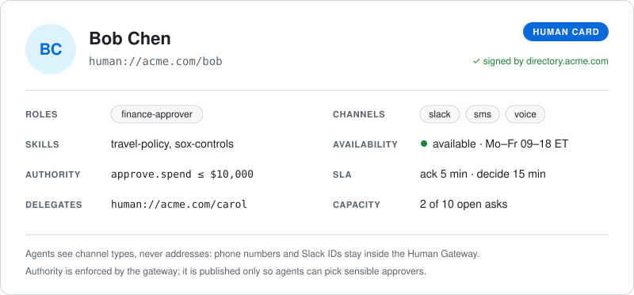
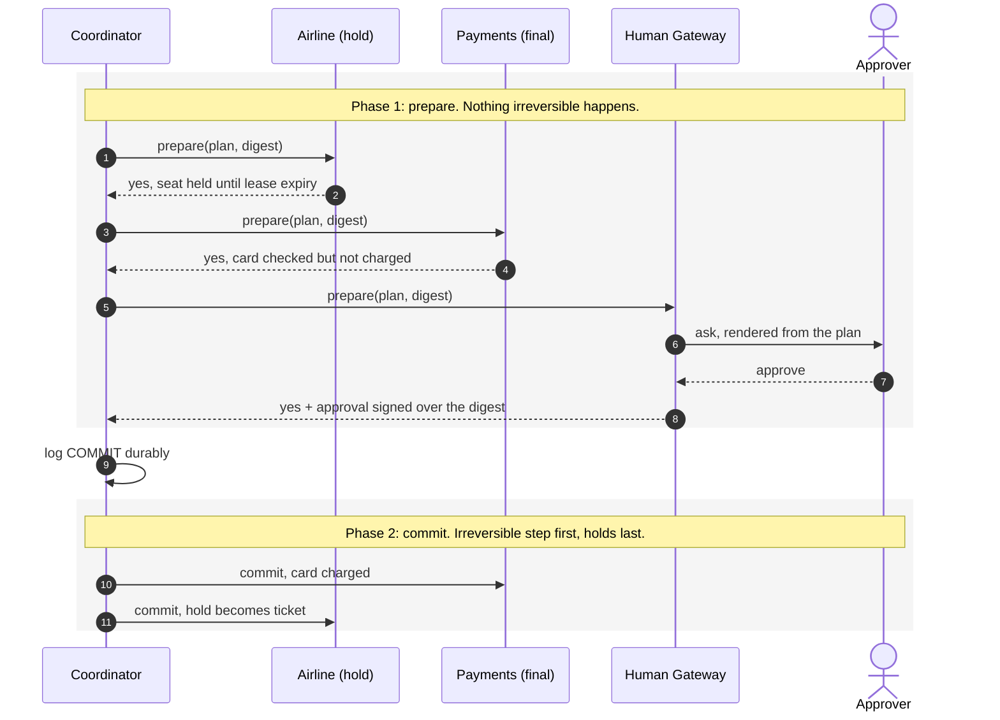
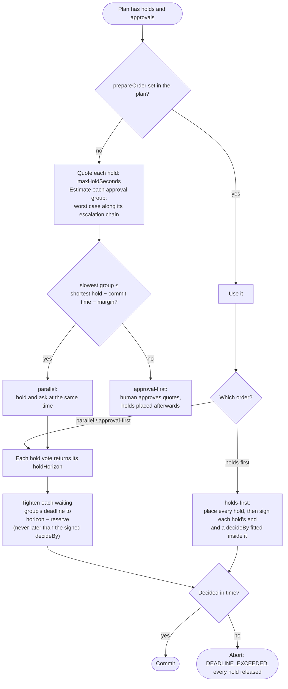
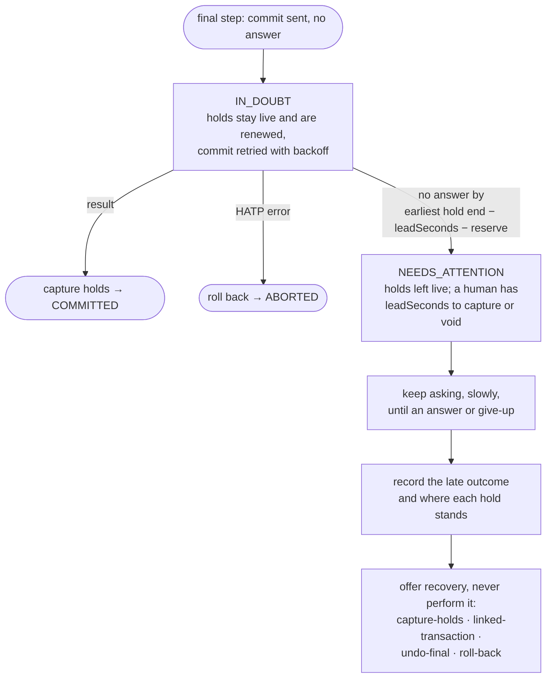

# HATP — Human-Agent Transaction Protocol

An open protocol that lets AI agents **find the right human**, run **multi-step actions as one all-or-nothing transaction** across tool servers, and make a **human approval a signed vote** in that transaction.

> "Book the flight and hotel, add the calendar entry, charge the card — but only if a finance approver agrees within 15 minutes. Otherwise, nothing happens."

| Path | What |
|---|---|
| [spec/hatp-v0.1.md](spec/hatp-v0.1.md) | Protocol spec v0.1: Discovery, Transactions, Evidence, MCP binding |
| [spec/schemas/hatp.schema.json](spec/schemas/hatp.schema.json) | JSON Schema for all core types |
| [sdk/](sdk/) | TypeScript reference SDK, [`hatp-protocol`](https://www.npmjs.com/package/hatp-protocol) on npm (zero runtime dependencies, Node ≥ 23.6) |
| [mcp/](mcp/) | MCP binding, `hatp-mcp`: participants and Human Gateways as MCP servers |
| [demo/](demo/) | Trip-booking demos: a browser approver, and tool servers over MCP |

## Human Cards

Agents find people the way they find other agents. A2A publishes an Agent Card for each agent; HATP publishes a **Human Card** for each person who can make decisions. The card lists what the person may approve, how fast they usually answer, who covers for them, and which kinds of channel reach them. A directory signs every card.

<p align="center"></p>

Agents address people by role, not by name: `human://acme.com/role/finance-approver?quorum=1-of-3&exclude=human://acme.com/dana`. The Human Gateway uses the cards to choose who to ask, and escalates to a delegate when someone misses their SLA. See [spec §4](spec/hatp-v0.1.md) for the full card format, addressing and resolution rules.

An agent finds an organisation the way a browser finds its keys: at a well-known URL. `https://acme.com/.well-known/human-card.json` names acme.com's Directory and Human Gateway and lists the keys that sign its Human Cards. It describes no individual person, and contact details stay inside the gateway.

```json
{
  "hatp": "0.1",
  "org": "acme.com",
  "issuers": [{ "id": "https://directory.acme.com", "keys": [{ "kid": "https://directory.acme.com#2026-1", "kty": "OKP", "crv": "Ed25519", "x": "…" }] }],
  "directory": { "participant": "mcp://gateway.acme.com/hatp", "mcp": "https://gateway.acme.com/mcp" },
  "gateway":   { "participant": "mcp://gateway.acme.com/hatp", "mcp": "https://gateway.acme.com/mcp" }
}
```

The document can only speak for the domain that serves it: `org` must match the host. See [spec §4.5](spec/hatp-v0.1.md).

## How it works

A transaction is two-phase commit in which the human is one more participant. In phase 1 every tool server gets ready without doing anything lasting, and the approver signs a digest of the exact plan. Phase 2 starts only after every participant votes yes and the coordinator has durably logged the decision. A single "no" from anyone, the human included, releases everything.



If any vote is "no", or a deadline passes, the coordinator logs ABORT, releases every hold and withdraws the open asks. The result is a signed, hash-chained Transaction Record that anyone can verify offline.

### Fitting the human into the hold window

A held seat or card authorization only lasts so long, and the human's decision time comes out of that window. The coordinator plans around it:



*reserve* is commit time plus a safety margin, plus the escalation lead time when the plan has an irreversible step (next section).

The chosen order is written into the plan before the human signs it. A tightened deadline only ends the wait sooner: the approval stays bound to the plan the human saw. In **`holds-first`** the holds are placed before anyone is asked, so their ends are known: they go into the plan the human signs, along with an approval deadline fitted inside them, and no commit may start past them. If what is left is too short for the approver's escalation chain, the coordinator aborts before asking anyone. The spec covers the details in §5.4, §7.9 and §7.10.

### When the irreversible step doesn't answer

If the `final` step's commit times out, the card may or may not have been charged. Capturing the holds or voiding them would each be a guess, so the transaction is **in doubt**: the holds stay live while the coordinator retries the idempotent commit, which doubles as a status query.



A card authorization usually has a fixed window (Stripe's `capture_before`, for example), so a human needs time to act before it ends. The plan's `escalation.leadSeconds` sets that time, and the coordinator escalates that far ahead. If the airline answers after an authorization lapsed, the coordinator records it and offers a **linked transaction** with its own approval. It never re-charges on its own: re-authorizing a card is merchant initiated, so unless the plan recorded the payer's off-session consent up to that amount (`recovery.offSessionReauth`), the payer has to be brought back. See spec §5.3 and §6.5.

## Run it

From the repo root (an npm workspace with `sdk/` and `mcp/`):

```bash
npm install
npm run build          # hatp-mcp and the MCP demo use the built hatp-protocol
npm test               # protocol and MCP binding tests
npm run typecheck

# Interactive: open http://localhost:4321 and act as the approver
node demo/trip.ts

# Non-interactive scenarios
node demo/trip.ts --auto
node demo/trip.ts --auto --scenario=hotel-sold-out   # one NO vote → every hold released
node demo/trip.ts --auto --scenario=card-declined    # irreversible step fails → calendar compensated, holds released
node demo/trip.ts --auto --scenario=escalate         # approver misses SLA → routed to delegate

# Airline and hotel as separate MCP server processes over stdio
npm run demo:mcp
```

Each browser-demo run writes a signed, hash-chained Transaction Record to `demo/out/` and verifies it offline.

### Releasing

Bump `version` in `sdk/package.json` and/or `mcp/package.json` in a PR. When it merges, the [Release workflow](.github/workflows/release.yml) builds and tests, then publishes every version that isn't on npm yet, `hatp-protocol` first. It uses npm trusted publishing, so no npm token is stored in GitHub, and each release carries provenance linking it to the commit that built it.

## SDK at a glance

```ts
import { createCoordinator, createResourceParticipant, createHumanGateway, Directory } from "hatp-protocol";

const airline = createResourceParticipant({ id, signer, operations: {
  book_seat: { tier: "hold", prepare: placeHold, commit: ticket, abort: releaseHold },
}});
const gateway = createHumanGateway({ id, signer, directory, channel /* Slack, SMS, web… */ });
const coordinator = createCoordinator({ id, signer, participants, gateways: { "acme.com": gateway.id } });

const record = await coordinator.run(plan);   // COMMITTED | ABORTED | NEEDS_ATTENTION
```

### Over MCP

An existing MCP server becomes a participant with one call, and the coordinator reaches it through an MCP client:

```ts
import { serveHatp, mcpParticipant, mcpDirectory } from "hatp-mcp";

// In the tool server, before connecting it:
serveHatp(mcpServer, airline, { version: "0.1", roles: ["participant"],
  operations: { book_seat: { tier: "hold", maxHoldSeconds: 1800 } }, keys: [signer.publicJwk] });

// In the coordinator, after connecting an MCP client to it:
const remoteAirline = mcpParticipant("mcp://airline.example/hatp", client, { keyring });

// An agent looking up who can approve, from a gateway that also serves its Directory:
const candidates = await mcpDirectory("mcp://gateway.acme.com/hatp", gatewayClient)
  .resolve({ address: "human://acme.com/role/finance-approver", requirement: { action: "approve.spend", amount: { value: 2140, currency: "USD" } } });
```

## Prior art

HATP's transaction model is classic two-phase commit with the human as a voter. The single irreversible step follows the **last resource commit** technique from XA transaction managers. [Narayana](https://narayana.io/) (the JBoss transaction manager) enforces the same one-last-resource rule by default and calls the override "transactionally unsafe". Discovery builds on A2A Agent Cards, and the transport is MCP. Spec [Appendix A](spec/hatp-v0.1.md) lists the rest.

## Roadmap

Shipped in 0.1.x, after feedback on the draft:

- Holds report how long they can last (`holdHorizon`), and the coordinator plans the human wait around it: it chooses `parallel` or `approval-first` from the clock, shortens the approval deadline to fit the tightest hold, and renews holds while the human decides.
- An MCP binding (`hatp-mcp`): participants and Human Gateways as MCP servers. Both packages are on npm.
- Guidance on choosing a tier: a reservation whose confirm can still fail is `final`, not `hold`.

Shipped in 0.1.3, toward the [v0.2 milestone](https://github.com/probita-ai/hatp/milestone/1):

- **In-doubt final step:** a timeout is no longer treated as a failure. Holds stay live while the coordinator retries the idempotent commit, and it escalates `escalation.leadSeconds` before the first hold ends.
- **Late outcomes:** after escalating, the coordinator keeps asking, records a late answer, and offers recovery without performing it.
- **`holds-first` mode:** hold ends and a fitted approval deadline go into the signed plan.
- **Directory resolution over MCP** (`hatp/directory/resolve`).
- **Organisation discovery** at `/.well-known/human-card.json`: an organisation's Directory, Human Gateway and card issuer keys.

Next:

- Deferred `pending` votes and locks.
- Then **Sessions** (asynchronous asks, live calls) and an A2A binding. See spec [§11](spec/hatp-v0.1.md).

## Status and known gaps (v0.1)

- Asks are answered synchronously inside `prepare`; the spec's `pending` vote and polling (§7.1, §7.7) are not implemented yet.
- Locks (§7.6) are specified, not implemented.
- Approvals in the demo are `gateway-attested` with a simulated click; real deployments should use WebAuthn/passkeys.
- The bare npm name `hatp` is taken by an unrelated package; this SDK is published as `hatp-protocol`.
