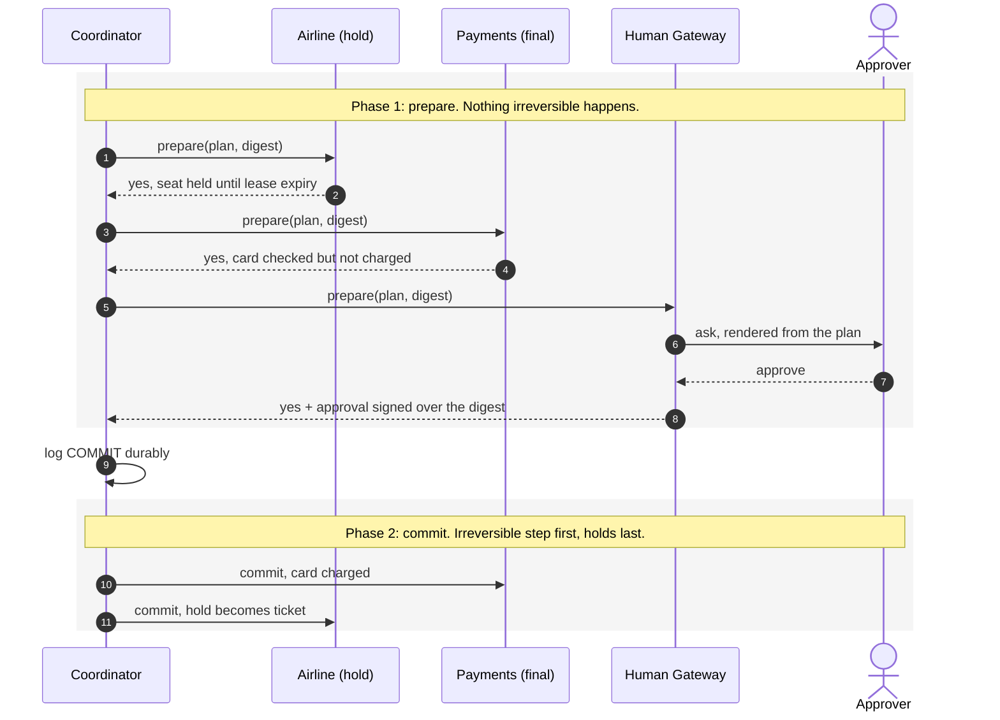
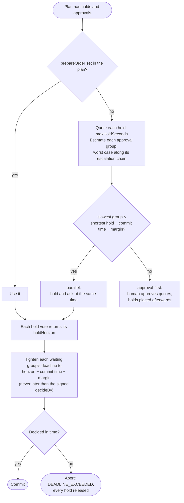

# HATP — Human-Agent Transaction Protocol

An open protocol that lets AI agents **find the right human**, run **multi-step actions as one all-or-nothing transaction** across tool servers, and make a **human approval a signed vote** in that transaction.

> "Book the flight and hotel, add the calendar entry, charge the card — but only if a finance approver agrees within 15 minutes. Otherwise, nothing happens."

| Path | What |
|---|---|
| [spec/hatp-v0.1.md](spec/hatp-v0.1.md) | Protocol spec v0.1: Discovery, Transactions, Evidence, MCP binding |
| [spec/schemas/hatp.schema.json](spec/schemas/hatp.schema.json) | JSON Schema for all core types |
| [sdk/](sdk/) | TypeScript reference SDK (zero runtime dependencies, Node ≥ 23.6) |
| [demo/](demo/) | Trip-booking demo with a browser approver |

## How it works

A transaction is two-phase commit in which the human is one more participant. In phase 1 every tool server gets ready without doing anything lasting, and the approver signs a digest of the exact plan. Phase 2 starts only after every participant votes yes and the coordinator has durably logged the decision. A single "no" from anyone, the human included, releases everything.



If any vote is "no", or a deadline passes, the coordinator logs ABORT, releases every hold and withdraws the open asks. The result is a signed, hash-chained Transaction Record that anyone can verify offline.

### Fitting the human into the hold window

A held seat or card authorization only lasts so long, and the human's decision time comes out of that window. The coordinator plans around it:



The chosen order is written into the plan before the human signs it. A tightened deadline only ends the wait sooner: the approval stays bound to the plan the human saw. The spec covers the details in §5.4, §7.9 and §7.10.

## Run it

```bash
cd sdk
npm install            # dev tools only (TypeScript types)
npm test               # protocol tests
npm run typecheck

# Interactive: open http://localhost:4321 and act as the approver
node ../demo/trip.ts

# Non-interactive scenarios
node ../demo/trip.ts --auto
node ../demo/trip.ts --auto --scenario=hotel-sold-out   # one NO vote → every hold released
node ../demo/trip.ts --auto --scenario=card-declined    # irreversible step fails → calendar compensated, holds released
node ../demo/trip.ts --auto --scenario=escalate         # approver misses SLA → routed to delegate
```

Each run writes a signed, hash-chained Transaction Record to `demo/out/` and verifies it offline.

## SDK at a glance

```ts
import { createCoordinator, createResourceParticipant, createHumanGateway, Directory } from "hatp-protocol";

const airline = createResourceParticipant({ id, signer, operations: {
  book_seat: { tier: "hold", prepare: placeHold, commit: ticket, abort: releaseHold },
}});
const gateway = createHumanGateway({ id, signer, directory, channel /* Slack, SMS, web… */ });
const coordinator = createCoordinator({ id, signer, participants, gateways: { "acme.com": gateway.id } });

const record = await coordinator.run(plan);   // COMMITTED | ABORTED | NEEDS_ATTENTION
```

## Status and known gaps (v0.1)

- Participants are called in-process. The JSON-RPC / MCP transport binding (spec §9) is specified but not yet implemented in the SDK.
- Asks are answered synchronously inside `prepare`; the spec's `pending` vote and polling (§7.1, §7.7) are not implemented yet.
- Locks (§7.6) are specified, not implemented.
- Holds are renewed only right before commit, not continuously while waiting for humans.
- Approvals in the demo are `gateway-attested` with a simulated click; real deployments should use WebAuthn/passkeys.
- The bare npm name `hatp` is taken by an unrelated package; this SDK is published as `hatp-protocol`.
