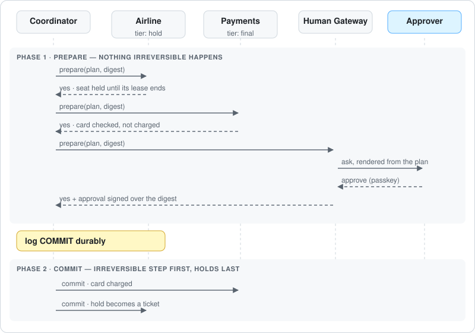

# hatp-mcp

MCP binding for **HATP**, the Human-Agent Transaction Protocol. It lets an existing MCP server take part in an all-or-nothing transaction, as a tool participant or as a Human Gateway, and lets a coordinator reach those servers over MCP.

It builds on [`hatp-protocol`](https://www.npmjs.com/package/hatp-protocol) and the official [`@modelcontextprotocol/sdk`](https://www.npmjs.com/package/@modelcontextprotocol/sdk). This is a draft protocol, and the API may change.

## How it fits

The coordinator is an MCP **client**. Each tool server, and each organisation's Human Gateway, is an MCP **server** that advertises the `ai.probita/human-gateway` extension with an `hatp` member and answers the `hatp/txn/*` methods next to its ordinary tools. A transaction then runs as two-phase commit over those sessions, with the human's approval as one of the votes:

<p align="center"></p>

| Method | Served by | Purpose |
|---|---|---|
| `hatp/txn/prepare`, `commit`, `abort` | every participant | Vote, then carry out or cancel |
| `hatp/txn/quote`, `renew`, `compensate` | tool servers (`participant` role) | Price without holding, keep a hold alive, undo |
| `hatp/txn/estimate`, `tighten` | Human Gateways (`human-gateway` role) | Worst-case decision time; shorten the human deadline to fit a hold |
| `hatp/directory/resolve` | Directories (`directory` role) | Rank the humans who can approve something |

See [`hatp-protocol`](https://www.npmjs.com/package/hatp-protocol) for tiers, prepare orders and what happens when the irreversible step doesn't answer.

## Install

```bash
npm install hatp-mcp hatp-protocol
```

Upgrading from 0.1? Upgrade Human Gateways first, and see [the upgrade notes](https://www.npmjs.com/package/hatp-protocol#upgrading-from-01).

Requires Node 23.6 or later.

## Server: make an MCP server a participant

`serveHatp` advertises `capabilities.extensions["ai.probita/human-gateway"].hatp` and handles the `hatp/txn/*` methods by delegating to a `hatp-protocol` participant. Your existing tools are untouched and stay callable outside any transaction. Call it before connecting the server.

```ts
import { McpServer } from "@modelcontextprotocol/sdk/server/mcp.js";
import { StdioServerTransport } from "@modelcontextprotocol/sdk/server/stdio.js";
import { createResourceParticipant, createSigner } from "hatp-protocol";
import { serveHatp } from "hatp-mcp";

const id = "mcp://airline.example/hatp";
const signer = createSigner(id);                 // key id: "mcp://airline.example/hatp#key-1"
const airline = createResourceParticipant({ id, signer, maxHoldSeconds: 1800, operations: {
  book_seat: { tier: "hold", prepare: placeHold, commit: ticket, abort: releaseHold },
}});

const server = new McpServer({ name: "airline", version: "1.0.0" });
serveHatp(server, airline, {
  version: "0.1",
  roles: ["participant"],
  operations: { book_seat: { tier: "hold", maxLeaseSeconds: 1800, maxHoldSeconds: 1800 } },
  keys: [signer.publicJwk],
});
await server.connect(new StdioServerTransport());
```

A Human Gateway is served the same way, with `roles: ["human-gateway", "directory"]`. Pass its `Directory` so the server also answers `hatp/directory/resolve`:

```ts
serveHatp(server, gateway, { version: "0.1", roles: ["human-gateway", "directory"], keys: [signer.publicJwk] }, { directory });
```

Without a `directory`, resolve requests are answered as not supported. A server that is only a Directory passes `undefined` as the participant.

## Client: coordinate MCP servers

`mcpParticipant` turns a connected MCP client into a participant for `createCoordinator`:

```ts
import { Client } from "@modelcontextprotocol/sdk/client/index.js";
import { StdioClientTransport } from "@modelcontextprotocol/sdk/client/stdio.js";
import { KeyRing, createCoordinator } from "hatp-protocol";
import { mcpParticipant } from "hatp-mcp";

const keyring = new KeyRing();
const client = new Client({ name: "coordinator", version: "1.0.0" });
await client.connect(new StdioClientTransport({ command: "node", args: ["airline-server.js"] }));
const airline = mcpParticipant("mcp://airline.example/hatp", client, { keyring });

const coordinator = createCoordinator({ id, signer, participants: (id) => [airline /* … */].find((p) => p.id === id), keyring });
```

## Client: look up humans from a remote Directory

`mcpDirectory` lets an agent find who can approve something before it builds a plan:

```ts
import { mcpDirectory } from "hatp-mcp";

const directory = mcpDirectory("mcp://gateway.acme.com/hatp", gatewayClient);
const { candidates, quorum } = await directory.resolve({
  address: "human://acme.com/role/finance-approver?quorum=1-of-3",
  requirement: { action: "approve.spend", amount: { value: 2140, currency: "USD" } },
  exclude: ["human://acme.com/dana"],                  // the person the agent acts for
});
// candidates: [{ id: "human://acme.com/bob", score: 0.92, reasons: ["available", "authority-ok", "load 2/10"] }, …]
```

Results are advisory: the Human Gateway makes the final choice when it asks. The server's clock decides deadlines; the caller cannot supply one. Results go out as the Directory produces them, so a Directory that serves agents outside its organisation coarsens availability and load itself.

## Approvals for single tool calls (Human Gateway extension)

The [Human Gateway SEP](https://github.com/probita-ai/hatp/blob/main/spec/sep/0000-human-gateway.md) gets a signed human approval for one `tools/call`, outside any transaction, and lets the server that runs the tool refuse it without one. It uses the extension `ai.probita/human-gateway`.

**Gateway:** answer `hatp/ask/approve` and serve Human Cards as `human://` resources:

```ts
import { serveHumanGateway } from "hatp-mcp";

serveHumanGateway(gatewayServer, gateway, {               // gateway: createHumanGateway with a channel that has deliverAction
  extension: { gatewayId: "https://gateway.acme.com", orgs: ["acme.com"], keys: [signer.publicJwk], assurance: ["gateway-attested", "human-signed"] },
  cards: directory,                                       // served as their issuer signed them
  principal: (extra) => extra.authInfo?.extra?.human as string | undefined, // who is asking: never their own approver
});
```

**Gated server:** register tools as usual, then gate the ones that need an approval:

```ts
import { gateTools } from "hatp-mcp";
import { createApprovalGate } from "hatp-protocol";

gateTools(payments, {
  gate: createApprovalGate({ serverId: "https://payments.example", trustedGateways: { "https://gateway.acme.com": gatewayKeys } }),
  extension: { serverId: "https://payments.example", trustedGateways: ["https://gateway.acme.com"] },
  tools: { charge_card: { requires: { address: "human://acme.com/role/finance-approver", requirement: { action: "approve.spend", amountFrom: "/amount" } } } },
});
```

**Agent:** read what a tool requires, ask, and call with the approvals:

```ts
import { callGatedTool, humanGatewayClientCapabilities, mcpHumanGateway, requiresOf } from "hatp-mcp";
import { actionDigest } from "hatp-protocol";

const gwClient = new Client({ name: "agent", version: "1.0.0" }, { capabilities: humanGatewayClientCapabilities });
const gw = mcpHumanGateway(gwClient, { issuerKeys });
const requires = requiresOf(tool);                        // from payments' tools/list
const action = { type: "mcp.tools/call", server: "https://payments.example", tool: "charge_card", arguments: args } as const;
const { decision, approvals } = await gw.askApprove({ address: requires.address, requirement: requires.requirement, action, actionDigest: actionDigest(action), decideBy });
if (decision === "approve") await callGatedTool(paymentsClient, { name: "charge_card", arguments: args, approvals });
```

- A gated tool called without valid approvals fails with JSON-RPC `-32050` (`APPROVAL_REQUIRED` or `APPROVAL_INVALID`), not a tool result, and doesn't run. `APPROVAL_REQUIRED` repeats the tool's `requires`.
- An approval is used up only when the tool runs and returns without `isError`, and two concurrent calls can't share one.
- Put `toolDigest(tool)` in the action to bind the approval to the tool's definition as `tools/list` returns it: a changed description or schema then fails the check.
- `gateTools` wraps the handlers `McpServer` installed. Call it after registering the tools.
- **Waiting with MCP Tasks:** build the gateway's server with a task store, and asks return a task at once instead of holding the request open. `mcpHumanGateway` uses tasks when the server advertises them. Pass `{ signal }` to any ask to withdraw it: the task or the request is cancelled, and the humans are no longer asked.

  ```ts
  import { InMemoryTaskStore } from "@modelcontextprotocol/sdk/experimental/tasks";
  const gatewayServer = new McpServer(info, { taskStore: new InMemoryTaskStore(), capabilities: { tasks: { requests: {}, list: {}, cancel: {} } } });
  ```

### Questions: choose, form, free text

The same gateway asks questions that aren't approvals ([spec](https://github.com/probita-ai/hatp/blob/main/spec/hatp-asks.md)). Give the channel a `deliverQuestion`, and ask with `askQuestion`:

```ts
import { questionDigest, verifyAnswer } from "hatp-protocol";

const question = { kind: "choose", prompt: "Which flight?", options: [{ id: "ua1520", label: "UA 1520, 08:10" }, { id: "dl404", label: "DL 404, 11:45" }] } as const;
const { status, answers } = await gw.askQuestion({ address: "human://acme.com/role/travel-coordinator", question, questionDigest: questionDigest(question), decideBy, audience: "agent://acme.com/travel-bot" });
verifyAnswer(answers[0], { gatewayKeys: gw.extension.keys, question, audience: "agent://acme.com/travel-bot" }); // undefined: it holds
```

A human may decline, which passes the question to the next eligible person. `status` is `declined` only when everyone eligible declined or missed their SLA. Answers are checked against the question before the gateway signs them.

## Behavior

- **Capabilities (breaking in this release):** the HATP capability moved from `capabilities.experimental.hatp` to an `hatp` member of `capabilities.extensions["ai.probita/human-gateway"]`, next to the gateway and gated-server settings. Clients still accept servers built with hatp-mcp 0.2.0, but clients built with 0.2.0 don't see servers built with this release: upgrade clients first. `hatpCapabilityOf(client)` reads either location.
- **Errors:** HATP errors travel as JSON-RPC code `-32050` with `data.hatpCode` (and `data.code`, for the SEP), and arrive as `HatpError` with the same code. A method the server doesn't serve arrives as `NOT_SUPPORTED`.
- **Keys:** the client adds the keys a server advertises to your keyring, so the coordinator can verify that server's receipts. Keys are self-asserted, so a server may only advertise key ids that start with its own participant URI and `#`. A server that advertises any other key is rejected, which stops it from replacing another participant's key. If you need stronger assurance, pin keys out of band.
- **Timeouts:** a Human Gateway answers `prepare` only when the human decides, so `prepare` waits until the plan deadline (plus `prepareGraceMs`, 30 s by default). Other requests use `requestTimeoutMs`, which defaults to the MCP SDK's 60 s.

## Learn more

- [Spec §9, MCP binding, and §4.4, directory resolution](https://github.com/probita-ai/hatp/blob/main/spec/hatp-v0.1.md)
- [Repository and the MCP demo](https://github.com/probita-ai/hatp): `npm run demo:mcp` runs the airline and hotel as separate MCP server processes, and `npm run demo:gated` shows a gated `charge_card` blocked, approved, and refused on replay or changed arguments.

## License

Apache-2.0
