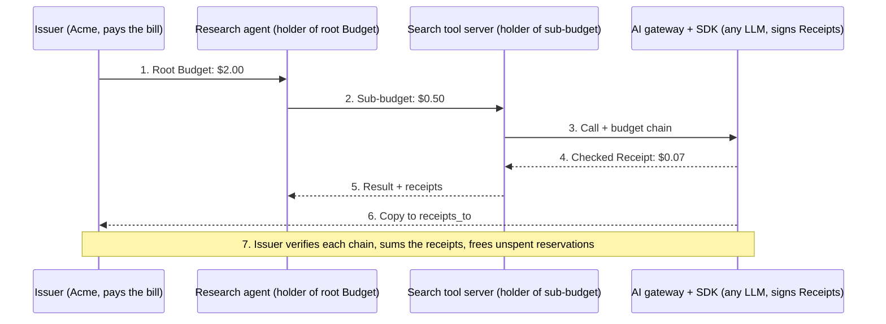

# Token Budgets & Receipts — Draft Spec

Oct 31, 2026 · Murthy Guruswamy

## Problem and goals

This spec proposes two linked objects: a **Budget**, a signed cap on what an agent may spend, which it can split among the agents and tools it calls; and a **Receipt**, a signed record of what each call actually used, linked back to its Budget.

Today a single user request can fan out across sub-agents, tool servers and models from any provider: OpenAI, Anthropic, Google, or open-weight models served on your own hardware. The spec and its SDK do not depend on any one provider. No one in that chain can cap what the next hop spends, and the final bill can only be checked against the provider's own invoice.

Goals:

- **Cap**: a caller can bound spend for any hop, in tokens, money or both.
- **Delegate**: a holder can split its Budget into smaller sub-budgets, never larger ones.
- **Prove**: every hop returns a Receipt that anyone holding the issuer's key can verify.
- **Reconcile**: the root issuer can add up Receipts and get the total cost of the whole chain.

Non-goals: moving money (left to payment rails such as x402), defining prices, or standardising tokenizers.

## Prior art

Parts of this idea already exist, but no open standard combines budgets you can delegate with signed receipts tied to them. That combination is what this spec proposes.

| Work | What it does | What it lacks for this spec |
| --- | --- | --- |
| [SatGate per-agent budgets](https://cloud.satgate.io/docs/guides/budgets) | Gateway enforces credit budgets on MCP tool calls; parents pass part of their credits to child tokens; refuses with HTTP 402 or JSON-RPC -32000 | A commercial product, not an open spec; budgets are enforced at its own gateway; no signed receipts |
| [IETF draft: AI Attestation Receipts](https://datatracker.ietf.org/doc/draft-chueayen-attestation-receipts/) (rev -05, Oct 2026) | Ed25519-signed JSON receipt per inference decision, optional hash chaining | Individual draft, not adopted; no token-usage fields; no budgets or delegation |
| [ProofMeter](https://github.com/proofmetercom) | SDK issuing Ed25519-signed, hash-chained usage receipts | Proprietary (patent pending); no budget delegation |
| [OpenTelemetry GenAI conventions](https://genkit.dev/docs/observability/otel-genai-semantic-conventions/) | Standard attribute names for token usage (`gen_ai.usage.input_tokens`, cache, reasoning) | Logs only: unsigned, not verifiable by a third party |
| Ethereum gas, macaroons | Prepaid execution limits; capability tokens that can only be narrowed | Not designed for LLM agents or tool calls |

**What this spec does differently**: an open format where the Budget travels with the request to any hop, not just one gateway, and each hop returns a Receipt that points back to the Budget that authorised it. It reuses OTel field names for usage, Ed25519 + JCS (RFC 8785) for signing, and macaroon-style narrowing for delegation.

**Limit to admit up front**: a signature proves a receipt was not altered after signing. It does not prove the provider counted tokens honestly. [Research on token inflation](https://arxiv.deeppaper.ai/papers/2605.30040v1) shows providers can over-count, and closing that gap needs trusted hardware or independent re-execution, which is out of scope here.

## Decision: new format, reusing the IETF draft's signing rules

We will start a new Receipt format rather than extend [draft-chueayen-attestation-receipts-05](https://datatracker.ietf.org/doc/html/draft-chueayen-attestation-receipts). We will copy its signing and verification rules exactly, so tools built for one can verify the other.

Why not extend it:

- It records a **policy decision** (`ALLOWED`, `BLOCKED`, `SUPPRESSED`), not usage. It has no token or cost fields; its only cost field, `cost_prevented_eur`, is explicitly not a security claim and should be `0`.
- Its schema is **closed**: verifiers must reject unknown top-level fields, and there is no extension mechanism. Adding `usage`, `budget` or `check` would need a new `v` from the author.
- It leaves delegation out of scope and refers it to [draft-luna-eagf-agent-delegation-semantics-00](https://datatracker.ietf.org/doc/draft-luna-eagf-agent-delegation-semantics/), which sets requirements only: no wire format and no spending caps.
- Both are individual drafts, not adopted by any working group. As far as the draft says, there is one implementation, by its own author.

What we copy from it:

| Rule | Adopted as |
| --- | --- |
| Ed25519 over a JCS (RFC 8785) payload, with the signature field removed | Same |
| Strict parsing: duplicate keys rejected, no U+FFFD substitution, keys sorted by UTF-16 code unit | Same |
| No numbers in exponential range in signed payloads | Same; money is a decimal string, so the issue only affects token counts and percentages |
| Unpadded base64url keys and signatures; hashes as 64 lowercase hex characters | Same (our `sha256:` prefix is dropped) |
| The key embedded in a record is never trusted on its own; verifiers pin it out of band | Same; DID resolution counts as "out of band" |
| Signature suite chosen by `v`, never guessed | Same |
| Verifiers de-duplicate on record id to stop replay | Same, on `id` |
| Published conformance test vectors | Same: the reference library ships pass/fail vectors |

Also from the delegation draft: its REQ-5 asks that records distinguish **self-report, platform record, and externally verifiable evidence**. That maps directly onto our *claimed*, *reported* and *measured* counts, and we will cite it.

Interop: a Receipt may carry an optional `attestation_id` pointing to an IETF-draft receipt for the same call, when a gateway issues both. We should reach out to the draft's author once our first version is written.

## Core concepts

The spec defines six roles and objects.

| Term | Meaning |
| --- | --- |
| Issuer | Whoever creates the root Budget and pays the bill: a user, an org, or a platform |
| Budget | Signed grant: "holder X may spend up to N units on scope S until time T" |
| Holder | The agent currently allowed to spend from a Budget |
| Sub-budget | A Budget derived from a parent by its Holder; always narrower (smaller cap, shorter expiry, tighter scope) |
| Meter | The service that counts and signs usage: usually an AI gateway running the SDK in front of any LLM provider, or a tool server |
| Receipt | Signed by a Meter: "call R used these tokens and cost this much, charged to Budget B" |

Units: a Budget caps tokens, money, or both. Tokens are counted per model as the Meter reports them (input, output, cache read, cache write, reasoning). Money is an ISO 4217 currency with a decimal string amount, for example `"0.20"` USD.

## Budget format

A Budget is a JSON object, canonicalised with JCS (RFC 8785) and signed with Ed25519 by its issuer or parent holder.

```json
{
  "v": 1,
  "type": "budget",
  "id": "bud_01JB8X3K2M",
  "parent": null,
  "issuer": "did:web:acme.example",
  "holder": "did:key:z6MkResearchAgent",
  "cap": {
    "money": { "currency": "USD", "amount": "2.00" },
    "tokens": 400000
  },
  "scope": {
    "models": ["openai:*", "anthropic:*", "google:*", "selfhosted:*"],
    "tools": ["search.*", "fetch"],
    "meters": ["did:web:gateway.acme.example"]
  },
  "not_before": "2026-10-31T10:00:00Z",
  "expires": "2026-10-31T11:00:00Z",
  "max_depth": 3,
  "receipts_to": "https://acme.example/budgets/receipts",
  "sig": { "alg": "Ed25519", "kid": "acme-2026-10", "value": "base64url..." }
}
```

Field rules:

- `cap`: at least one of `money` or `tokens`. When both are set, the call stops at whichever runs out first.
- `scope`: optional allow-lists. An empty or missing list means no restriction at that level.
- `max_depth`: how many more times this Budget may be split. `0` means no further delegation.
- `receipts_to`: optional URL where Meters also post Receipts, so the issuer can see spend as it happens.
- `sig`: covers every other field. `kid` is resolved from the signer's DID document.

## Delegation

A Holder can create sub-budgets for agents or tools it calls; each one can only narrow its parent, never widen it.

To delegate, the Holder signs a new Budget with `parent` set to the parent's `id` and attaches the parent chain, so a Meter can check every link back to the root issuer.

A sub-budget is valid only if all of these hold:

1. Its `cap` is at most the parent's remaining cap, in every unit the parent sets.
2. Its `scope` lists are subsets of the parent's.
3. Its `expires` is no later than the parent's, and `not_before` no earlier.
4. Its `max_depth` is less than the parent's.
5. It is signed by the key of the parent's `holder`.

**Reserving, not sharing.** When a Holder creates a sub-budget, it sets that amount aside from its own remaining cap. Siblings therefore can't spend the same money twice. Unspent reservations come back to the parent once the sub-budget expires or its holder closes it.

**Revocation.** An issuer can revoke any Budget in its tree by publishing its `id` at a revocation URL listed in the issuer's DID document. Meters check that list, cached for no more than 60 seconds, before accepting a call.

## Receipt format

A Meter returns one signed Receipt per call: what the call used, what it cost, and which Budget paid for it.

```json
{
  "v": 1,
  "type": "receipt",
  "id": "rcp_01JB8X9QF4",
  "budget": "bud_01JB8X7ZP1",
  "meter": "did:web:gateway.acme.example",
  "provider": "openai",
  "model": "gpt-5",
  "request_hash": "sha256:9f2c...",
  "response_hash": "sha256:41ab...",
  "usage": {
    "reported": {
      "input_tokens": 12840, "output_tokens": 1932,
      "cache_read_tokens": 9000, "cache_write_tokens": 0,
      "reasoning_tokens": 640
    },
    "measured": {
      "input_tokens": 12811, "output_tokens": 1932,
      "reasoning_tokens": null
    }
  },
  "check": {
    "verdict": "within_tolerance",
    "input_delta_pct": 0.23,
    "tolerance_pct": 2.0,
    "notes": ["reasoning tokens not countable by gateway"]
  },
  "cost": { "currency": "USD", "amount": "0.0731" },
  "price_ref": "https://gateway.acme.example/prices/openai/2026-10",
  "budget_remaining": { "money": "0.4269", "tokens": 85588 },
  "prev": "sha256:c07d...",
  "time": "2026-10-31T10:14:03Z",
  "sig": { "alg": "Ed25519", "kid": "gw-2026-10", "value": "base64url..." }
}
```

Field rules:

- `provider` + `model`: free strings (`openai`, `anthropic`, `google`, `mistral`, `selfhosted`, ...). The Receipt format is identical for every provider.
- `usage.reported`: what the provider's response said, translated into one shared set of names (OpenTelemetry `gen_ai.usage.*`) by the SDK's provider adapter.
- `usage.measured`: what the gateway counted itself (see next section). `null` means it can't be counted from outside, for example hidden reasoning tokens.
- `check`: the result of comparing the counts. `verdict` is one of `match`, `within_tolerance`, `mismatch`, `unverifiable`.
- `request_hash` / `response_hash`: let the caller prove which exchange a Receipt covers without exposing its content.
- `price_ref`: a price sheet the gateway publishes, so anyone can recompute `cost` from `usage.reported`.
- `prev`: hash of the Meter's previous Receipt for the same Budget. A gap in the chain shows a Receipt went missing.
- A tool server that calls a model on the caller's behalf returns its own Receipt **plus** the model's Receipts nested in `children`, so costs passed down the chain stay visible.

The example values are illustrative only, not real prices.

## Gateway SDK and token cross-check

The SDK is one library, independent of any provider, that plugs into an AI gateway. For every call it counts tokens itself, compares that count with what the provider billed and what the agent claimed, and only then signs a Receipt.

**Where it plugs in.** A core library plus thin adapters: middleware or plugins for existing gateways (LiteLLM, Portkey, Kong, Envoy AI Gateway, Cloudflare AI Gateway), or a client wrapper used directly in an agent's code when there is no gateway. TypeScript and Python first.

**Provider adapters.** Each adapter translates one provider's usage block into the shared names and supplies an independent counter.

| Provider | Usage the provider reports | How the SDK counts independently |
| --- | --- | --- |
| OpenAI | `usage.prompt_tokens`, `completion_tokens`, cached and reasoning details | Local tokenizer (`tiktoken`), exact for text |
| Anthropic | `usage.input_tokens`, `output_tokens`, cache read / creation | Provider's count-tokens endpoint (not independent; see note) |
| Google Gemini | `usageMetadata.promptTokenCount`, `candidatesTokenCount`, cached, thoughts | Provider's `countTokens` endpoint (not independent; see note) |
| Open-weight (Llama, Mistral, Qwen via vLLM, Ollama, etc.) | OpenAI-compatible `usage` | The model's own published tokenizer, exact |

Note: when a provider publishes no tokenizer, the second count comes from that same provider. That only catches billing mistakes, not deliberate over-counting. Where possible, the SDK also re-counts output with a close reference tokenizer and tracks how the ratio drifts.

**Three counts per call, six checks.**

- *Reported*: what the provider says it used, which is what you're billed.
- *Measured*: what the gateway counts from the request and response text.
- *Claimed*: what an agent or sub-agent reports to its parent.

1. **Input**: reported vs measured, within a tolerance set per model (default 2%, because providers add formatting tokens for system prompts and tools).
2. **Output**: reported vs measured on the visible response text.
3. **Hidden tokens** (reasoning or thinking): not countable from outside. They are compared with a rolling per-model baseline (ratio to output) and outliers are flagged; such checks are marked `unverifiable`, never `match`.
4. **Cost**: recompute `usage.reported` × `price_ref` and compare with the provider's charge, if one is returned.
5. **Agent claims**: an agent's claimed spend must equal the sum of its child Receipts. Any difference means a hop is under-reporting or hiding a call.
6. **Invoice**: the monthly provider invoice (CSV or usage API) is compared with the sum of Receipts per provider, model and day.

On `mismatch` the SDK can log, alert, or block the next call. That choice is a gateway policy setting.

**SDK modules.**

| Module | Job |
| --- | --- |
| `core` | Create, delegate and verify Budgets; sign and verify Receipts |
| `providers/*` | One adapter per provider: map usage fields, supply a counter |
| `gateways/*` | One plugin per gateway: hook request and response, enforce Budget |
| `counters/*` | Tokenizer plugins; reference tokenizers for providers without a public one |
| `reconcile` | Invoice import, per-day roll-up, discrepancy report |

## End-to-end flow

One request, end to end: the issuer funds an agent, the agent funds a tool, and the tool's model call comes back as a signed Receipt.



The tool server can spend only the $0.50 it was given, not the agent's full $2.00. Every Receipt reaches the issuer twice: once up the call chain and once directly, so a missing one stands out. Solid arrows are requests and dashed arrows are returns.

## Security and trust

The design can prove who authorised a spend and that nothing was altered or dropped afterwards. It cannot prove a Meter counted tokens honestly.

| Threat | Mitigation |
| --- | --- |
| Sub-agent spends more than allowed | Gateway checks the cap and the full parent chain before every call; refuses with `budget_exhausted` |
| Agent under-reports its spend upward | Check 5: claimed spend must equal the sum of signed child Receipts |
| Provider over-counts tokens | **Partly solved.** Visible input and output are re-counted by the gateway (checks 1-2). Hidden reasoning tokens can only be compared with a baseline (check 3). Full proof would need trusted-hardware attestation from the provider |
| Invoice differs from actual use | Check 6: invoice compared with the sum of Receipts per provider, model and day |
| Budget stolen and replayed | Short `expires`; `holder` bound to a key, with the caller signing each request (proof of possession); revocation list |
| Two siblings spend the same money | Reservation on delegation; gateways report `budget_remaining` |
| Gateway drops or alters a Receipt | `prev` hash chain per Budget; Ed25519 signature; optional copy posted to `receipts_to` |
| Budget leaks what you're working on | `scope` lists only tool and model patterns; content is never included, only hashes |

Keys are found through DIDs (`did:web` for organisations, `did:key` for short-lived agents), so no central registry is needed.

## MCP integration

MCP gets three small additions, all optional, so servers that don't support them keep working unchanged.

1. **Cost hints on tools.** `tools/list` entries may carry `annotations.cost`, for example `{"typical": {"currency":"USD","amount":"0.002"}, "max": {"currency":"USD","amount":"0.05"}, "meters_models": true}`. A client can then choose tools, or create a right-sized sub-budget, before it calls.
2. **Budget on the call.** `tools/call` carries the Budget chain in `_meta["io.tokenbudget/budget"]`. A server that consumes tokens checks the chain; one that doesn't simply ignores it.
3. **Receipt in the result.** The result returns Receipts in `_meta["io.tokenbudget/receipts"]`. When the budget runs out, the server returns JSON-RPC error `-32040 budget_exhausted` with `budget_remaining`, so the client can ask its parent for more.

HTTP APIs outside MCP use the same objects in a `Token-Budget` request header and a `Token-Receipt` response header (base64url JSON). Exhaustion maps to HTTP 402.

The `io.tokenbudget/` prefix and the `-32040` error code are placeholders until a SEP assigns them.

## Open questions and next steps

Open questions:

- Does a provider have any reason to sign Receipts? Probably only once enterprise buyers ask for it; a gateway (LiteLLM-style) could sign on the provider's behalf until then.
- Should Budgets reuse macaroons or Biscuit tokens rather than a new JSON format? This means trading easy reading against an existing, reviewed crypto design.
- Should token caps be per model, or converted into one standard unit (idea #3 from the brainstorm)?
- How does reservation work offline, when a Meter can't reach the issuer?
- Is it better to work with SatGate and the IETF receipts draft author, or to stay independent?

Next steps:

- [x] Done 31 Oct: read the IETF receipts draft (-05) and the delegation requirements draft; decided on a new format that reuses the draft's signing rules (see Decision section)
- [ ] Write a reference library (TypeScript): create Budget, delegate, verify chain, sign and verify Receipt
- [ ] Prototype the gateway SDK with OpenAI, Anthropic, Gemini and one self-hosted model behind a single gateway (LiteLLM is a likely first target), and run all six checks on real traffic
- [ ] Draft an MCP SEP for the `_meta` keys and the cost annotation
- [ ] Later: link human-attention budgets (idea #6) to this design, treating each human interrupt as one more Meter
